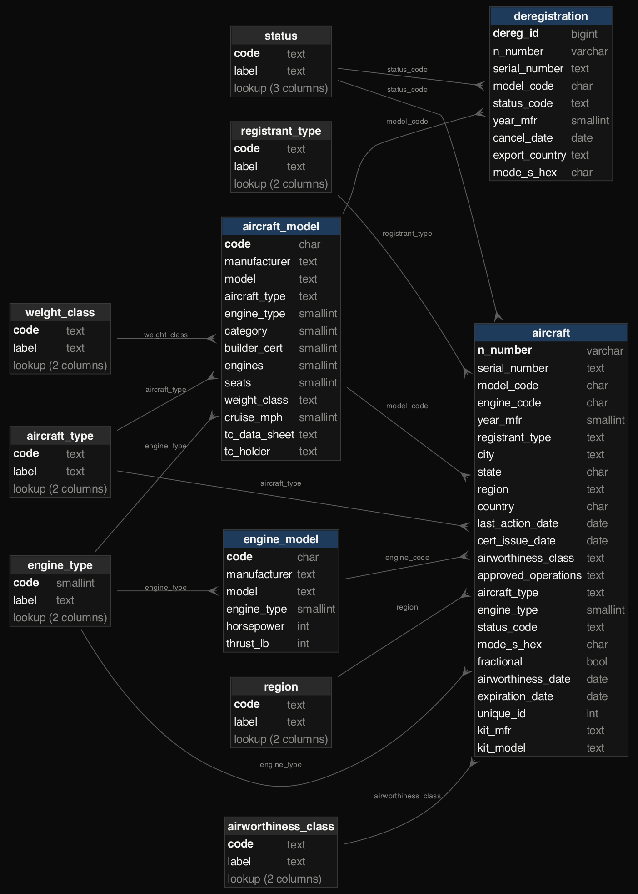

# FAA aircraft registry in PostgreSQL (database design and administration)

Every civil aircraft registered in the United States, 317,166 of them, plus 383,530 past deregistrations, loaded into
a PostgreSQL 18 database built the way a database administrator would build it:
- a normalised schema with every code checked against the FAA's own data dictionary;
- a staged load that logs every value it had to change;
- indexes chosen for real questions and timed before and after;
- views and a materialized summary;
- least-privilege roles;
- a backup that is actually restored and compared.

Build log: https://mrrishit909.github.io/projects/faa-aircraft-db/

## Data

FAA Civil Aviation Registry, *Releasable Aircraft Database* (public domain, updated daily; this copy 30 Sep 2026):
https://registry.faa.gov/database/ReleasableAircraft.zip. Field meanings come from the FAA data dictionary (`ardata.pdf`,
8 May 2025).

**Personal data stays out.** The master file holds registrant and co-owner names and street addresses. `prepare.py`
never loads names, street addresses, ZIP codes or county codes; only city, state and country are kept. Nothing
row-level is published, and `check.py` fails if a personal-data column appears in the database.

## Steps

| Step | File | What it does |
|---|---|---|
| 1 | `prepare.py` | download; trim fixed-width fields; drop personal fields; repair rows split by a stray comma |
| 2 | `sql/01_schema.sql`, `sql/02_load.sql` | schema with lookups, keys and checks; staged, logged load |
| 3 | `sql/03_indexes.sql`, `sql/perf_queries.sql` | six real questions timed with `EXPLAIN ANALYZE` before and after indexes |
| 4 | `sql/04_views.sql`, `sql/05_roles.sql` | readable views, a materialized summary, analyst and loader roles |
| 5 | `sql/06_insights.sql` | what the registry says |
| 6 | `run.py`, `run.sh` | runs it all against a private local PostgreSQL; then `pg_dump` → restore → compare |
| 7 | `check.py`, `charts.py` | tries to break every rule; ER diagram drawn from the live catalog |

## Design



- **Lookup tables for every code** (registrant type, aircraft type, engine type, status, airworthiness class, region,
  weight class), copied from the data dictionary. Foreign keys then reject any code the FAA never defined.
- **Rules the data must obey:**
  - N-numbers match the FAA format: `^[1-9][0-9A-HJ-NP-Z]{0,4}$`, so no letters I or O;
  - transponder (Mode S) codes are 6 hex digits and unique;
  - year built is 1903–2026;
  - expiration can't precede issue.
- **History needs its own key.** The same N-number reappears in the deregistration file as numbers are reused over the
  decades (82,373 repeats), so `deregistration` gets a surrogate identity key.
- **A constraint caught my own wrong assumption.** I first limited engines per model to 20. The load failed on the Velo X
  Velocitor X-1, a hybrid-lift design listed with 80 electric motors; Tetra and Taus list 32–33. The rule now allows
  0–99, the field's width.

## The load: nothing silently changed

Raw text goes into a `stage` schema, then typed rows into `faa`. A safe date-cast function returns NULL instead of
aborting the whole load. Every changed value is written to `faa.load_issue` first:

| Issue | Rows | Action |
|---|---:|---|
| Deregistration status codes B and C, not in the 2025 dictionary | 1,484 | set to NULL |
| Aircraft year built "0000" | 150 | set to NULL |
| Deregistration year outside 1903–2026 | 146 | set to NULL |
| Deregistration model code missing from the model table | 42 | set to NULL |
| Airworthiness class "0", not in the dictionary | 7 | set to NULL |
| Aircraft type differs from its model's reference type | 4 | kept as registered |
| Engine model with no engine type | 1 | set to 9 (Unknown) |

One deregistration row had a comma typed inside a name, which split a fixed-width field in two. `prepare.py` repairs
it by merging the two pieces whose widths add up to the field's width. A gotcha worth knowing: `COPY` reads an empty
CSV field as NULL, so `x = ''` tests silently match nothing.

All 317,166 aircraft, 94,091 models, 4,752 engines and 383,530 deregistrations load in about 15 seconds (227 MB).

## Indexes, measured

Median of 5 runs with `EXPLAIN ANALYZE`, before and after `sql/03_indexes.sql`:

| Question | Before | After | Index |
|---|---:|---:|---|
| Transponder code seen by an ADS-B receiver | 0.03 ms | 0.03 ms | already indexed by its UNIQUE constraint |
| Valid registrations expiring in 90 days | 12.37 ms | **0.03 ms** | partial index (valid only) |
| Aircraft based in Tampa, FL | 9.69 ms | **0.50 ms** | composite (state, city) |
| Models whose name contains "172" | 12.89 ms | **0.08 ms** | trigram (GIN) |
| Every registered Cessna 172 | 13.79 ms | 8.00 ms | foreign-key column |
| One N-number's history | 7.34 ms | **0.02 ms** | B-tree |

PostgreSQL indexes primary keys and UNIQUE columns automatically, but **not foreign-key columns**. The Cessna 172 join
gains least because it returns tens of thousands of aircraft: indexes speed up selective questions, not big result sets.

## Operations

- **Roles:**
  - `registry_analyst` can read tables and views but not change them or see the raw staging data;
  - `registry_loader` can write;
  - `PUBLIC` gets nothing.
- **Views:** `v_aircraft` (codes turned into labels), `v_expiring_90_days`, and the materialized view
  `mv_fleet_summary`, which has a unique index so it can be refreshed without blocking readers.
- **Backup:** `pg_dump -Fc` of the schema (21 MB), restored into a fresh database. Row counts and an MD5 checksum of
  every aircraft row match.
- **Server:** a private cluster in the project folder, reachable only through a local socket (no network port).

## What the registry says

- **An old fleet.** The median single-engine airplane was built in 1976. Most piston singles date from the 1960s and
  1970s (64,668 of them).
- **Drones have arrived.** Zipline's P2 Zip delivery drone (3,355 registered) and DJI's Agras T40 crop-spraying drone
  (1,841) are now among the 15 most-registered models. 17,734 aircraft have electric engines.
- **Where they go.** Since 2016 the most common export destinations are Brazil (2,302) and Canada (2,266), then Mexico
  and Australia.
- **Deregistration spikes** in 2013 (35,293) and 2018 (19,482). The 2013 peak coincides with the FAA's fleet-wide
  re-registration requirement of the early 2010s.
- **Renewal workload.** Almost no valid registrations expire before January 2027, then 750–7,300 a month through September 2028.

## Run it

```
python3 -m venv venv && ./venv/bin/pip install pandas matplotlib
./venv/bin/python prepare.py
./run.sh                       # PostgreSQL 18 binaries in ~/micromamba/envs/analyst/bin, or set PG=/path/to/bin
./venv/bin/python check.py && ./venv/bin/python charts.py
```

## Not done

- No daily incremental load (each run rebuilds). Production would load deltas and keep history with valid-from/to dates.
- No partitioning: at 300,000 rows it isn't needed.
- Deregistration records keep only model, dates and export country.
